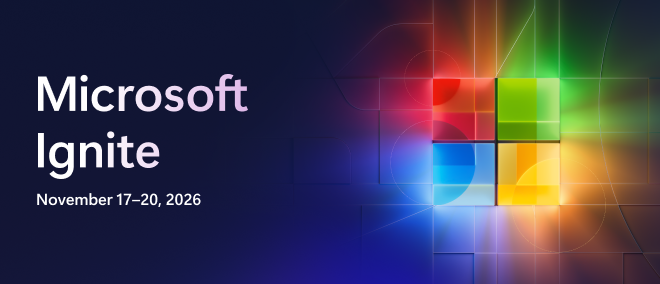

# [Microsoft Ignite 2026](https://ignite.microsoft.com)

## 🔥LAB741: From AI ambition to business advantage
### Session description

Define a clear 12-month AI aspiration and turn one initiative into a focused 90-day plan using the AI Impact Coach skill in Microsoft 365 Copilot. Start with a business problem, choose a measurable outcome, and leave with a saved plan that identifies a pilot, an accountable owner, and 30/60/90 milestones.

### 🚀 Getting started

The workshop includes separate environment and coach setup pages, followed by one continuous [core workshop page](instructions/Exercise02.md) containing **Steps 1-5**. Steps 6-7 are on a separate [optional review and pitch page](instructions/Exercise03.md). Allow about **35 minutes** for the core workshop and **5 minutes each** for the optional steps.

All participants use the **provided M365 user account** and the **AI Impact Coach skill** in Cowork throughout the workshop.

#### In a guided session

If you're following along during a live session:

1. Complete [Welcome to your lab environment](instructions/Exercise00.md) to sign in to the virtual machine and the **provided M365 user account**.
2. Follow the [workshop overview and setup](instructions/Exercise01.md) to verify that AI Impact Coach is available and start a new Cowork task.
3. Open the [workshop steps](instructions/Exercise02.md) and work through **Steps 1-5** in order on that page, keeping the same Cowork task open throughout the workshop. Scroll down the page to move between steps.
4. Save your plan after Step 5 and review the core-completion check on the same page. Continue to the [optional review and pitch](instructions/Exercise03.md) if time allows, keeping the same Cowork task open.

#### On your own

If you're learning at your own pace, start  the self-paced workshop at [aka.ms/Frontier_CIE](https://aka.ms/Frontier_CIE).

### 🎯 Learning outcomes

By the end of this session, you will be able to:

- Clarify a business problem and define a 12-month AI aspiration with one primary success metric.
- Identify AI initiatives and prioritize a focused 90-day pilot with clear risks and boundaries.
- Create a five-section 90-day plan with an accountable owner, a human judgment point, and 30/60/90 milestones.

### 💻 Technologies used

- [Microsoft Copilot](https://learn.microsoft.com/en-us/copilot/plan/copilot-overview)
- [Microsoft Copilot Cowork](https://learn.microsoft.com/en-us/copilot/cowork/) 

### 📚 Continue your learning

Pick your next step based on your learning style:

| Resource | What you'll get |
|----------|-----------------|
| **[Frontier CIE workshop resources](https://aka.ms/Frontier_CIE)** | Run the workshop again later with your Microsoft 365 work account, explore the prompts behind AI Impact Coach, or share the resources with colleagues |
| **[Ignite 2026 Next Steps](https://aka.ms/ignite26-next-steps)** | Additional session repos and materials from Microsoft Ignite 2026 |
| **[Microsoft AI Skills Navigator](https://aka.ms/ignite26-asn)** | Discover AI skills, learning paths, and resources for your next step |
| **[Microsoft Learn](https://aka.ms/ignite26-learn)** | Official documentation and guided learning paths on these topics |
| **[Microsoft Foundry Community](https://aka.ms/MicrosoftFoundryDiscord-Ignite26)** | Connect with other learners and experts in our Discord community |

### 👥 Content owners

<table>
<tr>
    <td align="center"><a href="https://github.com/maquinl">
         
        <b>Matt Quinlan</b></a> 
            <a href="https://github.com/maquinl" title="talk">📢</a>
    </td>
</tr></table>

### ⚖️ Trademarks

This project may contain trademarks or logos for projects, products, or services. Authorized use of Microsoft trademarks or logos is subject to and must follow [Microsoft's Trademark & Brand Guidelines](https://www.microsoft.com/legal/intellectualproperty/trademarks/usage/general). Use of Microsoft trademarks or logos in modified versions of this project must not cause confusion or imply Microsoft sponsorship.

Any use of third-party trademarks or logos are subject to those third-party's policies.
