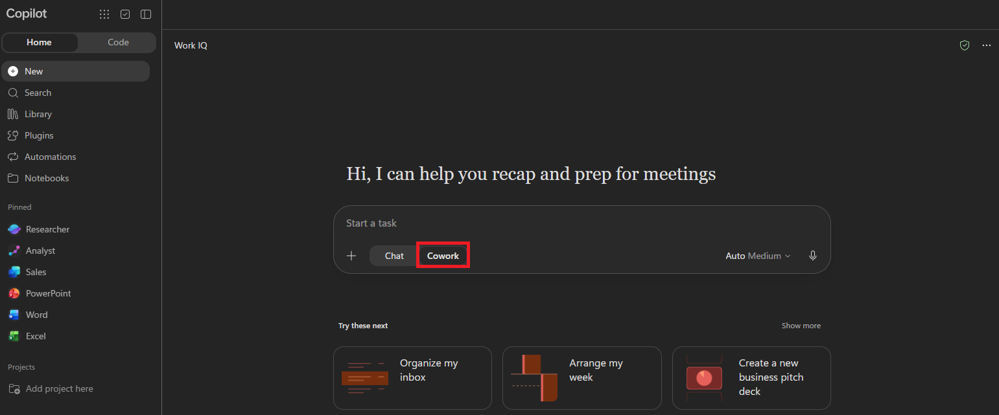
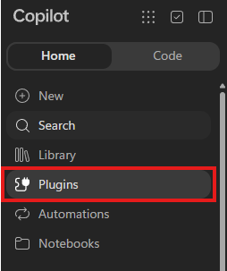
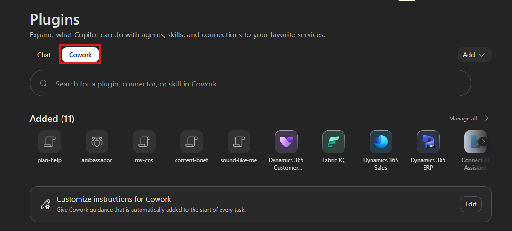
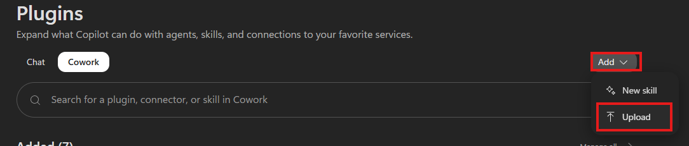
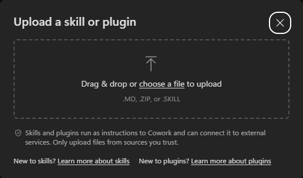

# Build your 90-day AI plan

Define a clear **12-month AI aspiration** and turn one initiative into a focused **90-day plan**.

**Workshop at a glance:** 35 minutes for the five core steps, plus two optional extra steps of about 5 minutes each.

> [!note] All participants use the provided **AlexW** workshop account and the **AI Impact Coach skill** in Cowork throughout this workshop. Install the skill before starting your workshop task.

## Use AI Impact Coach Skill

A **skill** is a reusable set of instructions that tells Cowork how to handle a specific task. The **AI Impact Coach** skill provides the workshop structure: it asks focused questions, helps refine your thinking, and builds your plan from the decisions you confirm.

The requests in each step call the coach skill by name instead of repeating its full instructions. Once the coach is active, reply naturally to its questions. You still supply the business context and make the decisions.

**Let Cowork guide the conversation.** Upload AI Impact Coach once, start a new task, and use the named request shown in each step. The coach helps develop your answers and carries confirmed decisions forward within your workshop task.

> [!hint] **The more you share, the better your plan.** The coach works best when you share specific business context: rough numbers, names, and the systems you use. Estimates are fine. Treat each draft as a starting point: push back, tweak, and ask follow-up questions until it sounds like you. Aim to reach Step 5 so you leave with your plan.

## Step 1 - Before you begin

1. [ ] Open [Microsoft 365 Copilot](https://m365.cloud.microsoft/chat/) and sign in with the provided **AlexW** workshop account.
1. [ ] With **Microsoft 365 Copilot Chat open**, select the **Cowork** tab below the prompt window.

   

    > [!note] **Use one Cowork task for the entire workshop.** Install AI Impact Coach before starting a new task.

### Set up the coach

1. [ ] Download [AI Impact Coach (SKILL.md)](downloads/90-day-plan/SKILL.md). On GitHub, open the file and select **Download raw file** to save it as **SKILL.md**. If you have downloaded or cloned this repository, use the included file in `instructions/downloads/90-day-plan/`.
1. [ ] In the left navigation, select **plugins**.

   

1. [ ] On the plugins page, select the **Cowork** tab.

   

1. [ ] Select **Add**, and then select **Upload**.

   

1. [ ] Drag the downloaded **SKILL.md** file into the upload area, or select **Choose file** to browse to it.

   

1. [ ] Once the skill is installed, return to **Cowork** and start a **new task** for the workshop. Use the request in each workshop step, including the skill name, to work with the coach.

    > [!note] **A new task is required after installation.** Tasks that were already running will not load the newly installed skill. Use the new task for the rest of the workshop. If you already completed any steps, copy your earlier decisions into it.

## Build your plan

Complete Steps 1-5 to clarify your problem, define your aspiration, choose an initiative, and save your plan. After Step 5, you can stop or continue to the optional review and executive pitch.

> [!note] **Check:** The AI Impact Coach skill is installed and you have a new Cowork task window open.

Select **Next** to open the workshop steps. Complete Steps 1-5, then continue to the optional Steps 6-7 if time allows.
