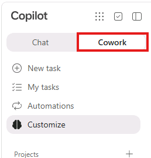
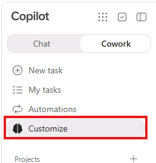
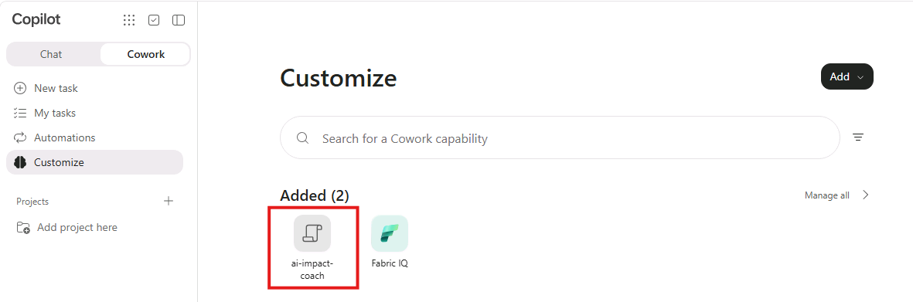
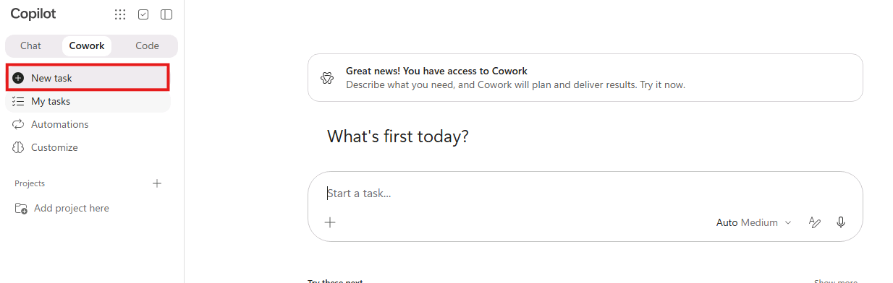
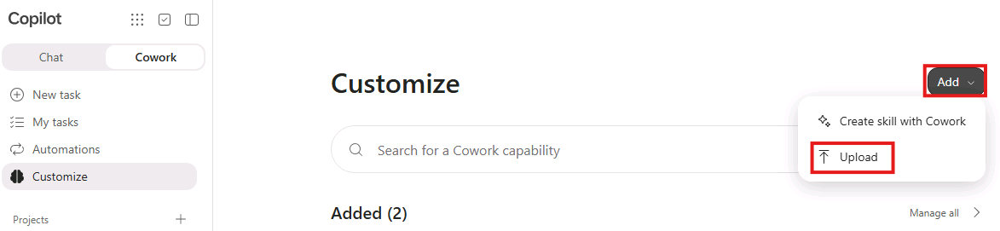
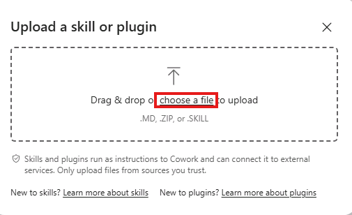
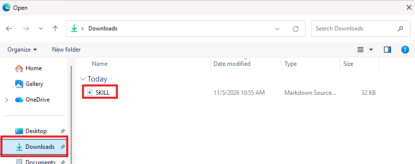
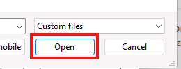

# Build your 90-day AI plan

## Use the AI Impact Coach skill

A **skill** is a reusable set of instructions that tells Cowork how to handle a specific task. The **AI Impact Coach** skill provides the workshop structure: it asks focused questions, helps refine your thinking, and builds your plan from the decisions you confirm.

As part of the lab setup process, the **AI Impact Coach** skill should already be available in Cowork. Verify that you can see it before starting your workshop task. Upload it manually only if it is missing.

**Let Cowork guide the conversation.** Verify that AI Impact Coach is available, start a new task, and send the prompt shown in each step. The coach helps develop your answers and carries confirmed decisions forward within your workshop task.

> [!hint] **Share useful context, not sensitive details.** Use only information you could share publicly. General business challenges, role descriptions, and publicly available examples are enough. Do not include trade secrets, confidential company or customer information, or personal data. If you use illustrative numbers, label them clearly as examples. Treat each draft as a starting point: push back, tweak, and ask follow-up questions until it sounds like you. Aim to reach Step 5 so you leave with your plan.

## Step 1 - Before you begin

1. [ ] Confirm that you're signed in to [Microsoft 365 Copilot](https://m365.cloud.microsoft/chat/). If not, sign in using the credentials below.

   - **Username:** +++@lab.CloudCredential(WWLM365E7).AdministrativeUsername+++
   - **Temporary access pass:** +++@lab.Variable(TAP)+++

    > [!Help] If the sign-in page asks for a password, use:
    >
    > **Password:** +++@lab.CloudCredential(WWLM365E7).AdministrativePassword+++

1. [ ] In **Microsoft 365 Copilot**, select the **Cowork** tab in the left navigation.

   

1. [ ] Select **Customize** in the left navigation.

   

1. [ ] On the **Customize** page, look under **Added** and verify that the **AI Impact Coach** skill appears as **ai-impact-coach**.

   

1. [ ] If the skill is visible, select **New task** and keep this task open for the entire workshop. Continue with **Build your plan** below. If the skill is missing, follow the manual-upload steps below before starting your task.

    

> [+Note] **Skill missing? Expand for manual upload steps.**
>
> Follow these steps only if **ai-impact-coach** is not listed on the **Customize** page.
>
> 1. [ ] While on the **Customize** page, select **Add**, then select **Upload**.
>
>     
>
> 1. [ ] In the **Upload a skill or plugin** prompt, select **choose a file**.
>
>     
>
> 1. [ ] In the window that opens, select **Downloads**, then select **SKILL** (**SKILL.md** if file extensions are visible).
>
>     
>
> 1. [ ] With the skill file selected, select **Open** to upload it.
>
>     
>
> 1. [ ] Verify that **ai-impact-coach** appears under **Added** on the **Customize** page. Then select **New task** to start your workshop task.
>
>     **A new task is required after installation.** Tasks that were already running will not load the newly installed skill. Use the new task for the rest of the workshop. If you already completed any steps, copy your earlier decisions into it.

Select **Next** to open the [workshop steps](Exercise02.md).
