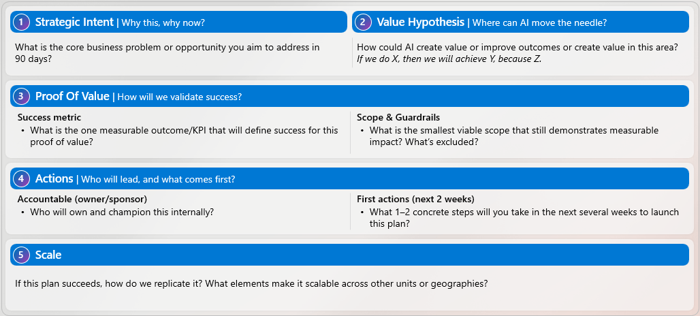
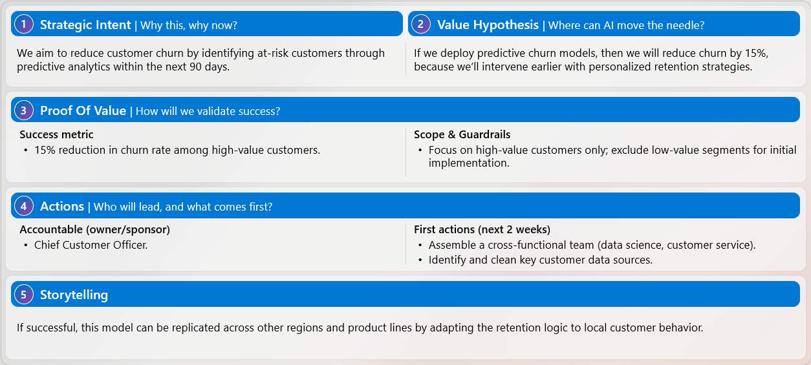

# Build your 90-day AI plan: workshop steps

Complete **Steps 1-5** for the core workshop in about **35 minutes**. **Steps 6-7** are optional extras of about **5 minutes each**.

Before you begin, complete the overview and setup to install **AI Impact Coach** and open a new Cowork task using the provided **AlexW** workshop account.

Work down this page in order, keeping the same Cowork task open.

---

## Step 1: Name the problem

**Time:** 5 minutes.

**Finish this step with:** a short, confirmed statement of a real problem affecting your business unit, function, or organization.

Start with a business problem your area is actually facing. A rough description is enough; Copilot will help you clarify it.

**Focus on organization-level outcomes, not individual productivity.** Keep the scope within your business unit or function, rather than a tool rollout or company-wide transformation.

> [!note] Continue in the same Cowork task throughout the workshop.

### Use AI Impact Coach

1. [ ] Send this request in your workshop task:

    ```text-nocolor
    Use the ai-impact-coach skill to clarify my business problem.
    ```

1. [ ] Share your business unit or function and a problem affecting its outcomes.

    > [!hint] **Not sure how to describe the problem?** Think about a recent process delay, rework, or service issue affecting your business unit, function, or customers. Describe what happened in your own words; Copilot can help you turn that real example into a clearer business problem statement.

1. [ ] Confirm the coach's wording, then continue to Step 2.

    > [!note] **Check:** You have confirmed a business problem statement that describes what is happening and why it matters.

---

## Step 2: Define your 12-month AI aspiration

**Time:** 5 minutes.

**Finish this step with:** a one-sentence 12-month AI aspiration and one primary success metric.

Define what better would look like for your business unit, function, or organization. You don't need baselines or targets yet; those come with the 90-day plan in Step 5.

> [!note] Continue in the same Cowork task.

### Use AI Impact Coach

1. [ ] Send this request:

    ```text-nocolor
    Use the ai-impact-coach skill to define my 12-month aspiration.
    ```

1. [ ] Refine the aspiration if needed and choose one metric that would show meaningful progress. Confirm both with the coach, then continue to Step 3.

    > [!note] **Check:** You have a one-sentence 12-month AI aspiration and one primary metric focused on a business outcome.

---

## Step 3: Identify your AI initiatives

**Time:** 5 minutes.

**Finish this step with:** one existing initiative contributing to your aspiration and one new opportunity that could accelerate it.

This is where you consider the systems or tools the work runs in. If you don't know them yet, say "not sure" and keep the recommendations high level.

> [!note] Continue in the same Cowork task.

### Use AI Impact Coach

1. [ ] Send this request:

    ```text-nocolor
    Use the ai-impact-coach skill to identify initiatives.
    ```

1. [ ] Share the systems or tools involved if the coach asks.
1. [ ] Confirm one existing initiative and one new opportunity with the coach, including a name and one-sentence description for each, then continue to Step 4.

    > [!note] **Check:** You have identified one existing initiative and one new opportunity. Any unknown systems or assumptions are clearly marked.

---

## Step 4: Prioritize your focus

**Time:** 5 minutes.

**Finish this step with:** one 90-day initiative, the biggest risk and a mitigation, and a clear out-of-scope line.

Choose the initiative most likely to deliver measurable value in 90 days, not the largest possible transformation.

> [!note] Continue in the same Cowork task.

### Use AI Impact Coach

1. [ ] Send this request:

    ```text-nocolor
    Use the ai-impact-coach skill to prioritize my focus.
    ```

1. [ ] Make the final choice yourself. Confirm your chosen initiative, main risk, mitigation, and what you will leave out of scope with the coach, then continue to Step 5.

    > [!note] **Check:** You have chosen one 90-day initiative and recorded its main risk, mitigation, and scope boundaries.

---

## Step 5: Design your 90-day plan

**Time:** 15 minutes.

**Finish this step with:** a saved five-section 90-day plan and 30/60/90 milestones.

Keep the pilot small. Your plan should identify one primary KPI, an accountable owner, and where a person reviews or decides before AI output reaches customers, production, or a final decision.

> [!note] Continue in the same Cowork task.

### Use AI Impact Coach

1. [ ] Send this request:

    ```text-nocolor
    Use the ai-impact-coach skill to draft my 90-day plan.
    ```

1. [ ] Review the draft with the coach. Check the accountable owner, pilot scope, and any placeholders.
1. [ ] Check the draft against this framework and ask the coach to refine anything that is missing or unclear.

    | Section | What to include |
    | --- | --- |
    | **Strategic Intent - Why this, why now?** | The business problem and why it matters now. |
    | **Value Hypothesis - Where can AI move the needle?** | "If we [specific action], then we will [measurable change], because [core assumption]." |
    | **Proof of Value - How will we validate success?** | One primary KPI, **baseline** to **target**, the smallest viable pilot, what is out of scope, and the human judgment point. |
    | **Actions - Who leads and what comes first?** | An accountable business owner and 1-2 concrete actions for the first 30 days. |
    | **Storytelling - How does this scale?** | What makes the approach repeatable across teams, regions, or business units, and which Frontier pattern it moves you toward. |

    For the Frontier pattern, choose **human with assistant**, **human-agent teams**, or **human-led, agent-operated**. Make clear where human judgment stays.

    If the baseline is unknown, ask the coach to include measuring it in the first 30-day actions.

1. [ ] Confirm the plan includes a short **30 / 60 / 90 milestone line**: set up and baseline, then pilot running, then measure and decide.
1. [ ] Ask the coach to save your confirmed plan as a **Word document**, then download it. If you ask for further changes, download the latest version before leaving.

### Optional reference: Plan template and completed example



Use the example for structure, not as your answer. Your plan should reflect your own priorities, constraints, and business context.



---

## Your core workshop is complete

**After completing Step 5, you can stop here.** Download the coach's Word document before leaving.

> [!note] **Check:** Your saved plan has all five sections, one primary KPI, an accountable owner, pilot boundaries, a human judgment point, and 30/60/90 milestones. Unknown facts, baselines, targets, or owners remain clearly marked as placeholders.

If you have time, you may continue to **Step 6** below.

---

## Step 6: Review your draft

**Optional - time:** 5 minutes.

**Finish this step with:** a stronger plan with clearer assumptions, scope, metrics, and ownership.

> [!note] Your core workshop is complete after Step 5. Continue if you have time.

### Use AI Impact Coach

1. [ ] In the same workshop task, send this request:

    ```text-nocolor
    Use the ai-impact-coach skill to review my draft plan.
    ```

1. [ ] If your draft isn't already in the task, share it when the coach asks.
1. [ ] Confirm which suggested edits to accept with the coach. Ask it to apply those edits to your Word plan, then download the latest version.

    > [!note] **Check:** You have accepted or rejected the suggested edits and saved the version of the plan you want to keep.

---

## Step 7: Create your 1-minute pitch

**Optional - time:** 5 minutes.

**Finish this step with:** a concise pitch for the stakeholder whose backing you need.

> [!note] This is an optional extra. You can also finish the workshop with the plan you have already saved.

### Use AI Impact Coach

1. [ ] In the same workshop task, send this request:

    ```text-nocolor
    Use the ai-impact-coach skill to build my 1-minute pitch.
    ```

1. [ ] Tell the coach who your stakeholder is and refine the pitch so it sounds like you.
1. [ ] Ask the coach to add the confirmed pitch to your Word plan, then download the final version.

    > [!note] **Check:** Your saved pitch is tailored to your stakeholder, includes a clear ask and owner, and uses only facts and metrics from your plan.

Congratulations, you have completed the workshop. Take your saved plan and executive pitch with you. Validate all metrics and baselines before sharing them.
